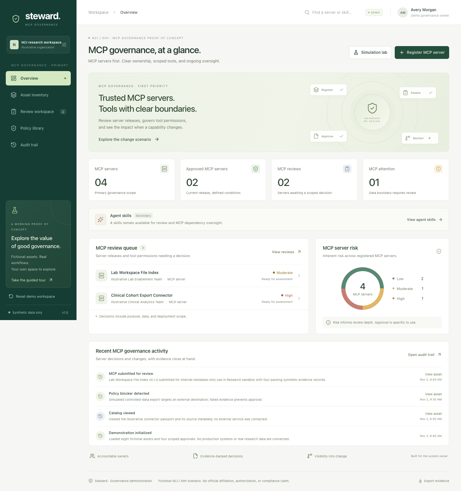

# Steward — AI Asset Governance

A deployable, browser-only proof of concept focused on **MCP server governance** in an NIH/NCI setting. Steward brings server review, scoped tool permissions, dependency changes, and evidence into one workflow. Agent skills are a secondary asset type that supports reuse and demonstrates downstream MCP impact.

All assets, people, decisions, endpoints, and evidence are synthetic. This is a product demonstration, not an NIH service or a compliance certification. Do not enter patient information, controlled research data, credentials, or other nonpublic government information.

## What the demo does



The layout also works on small screens: [mobile preview](docs/screenshots/mobile.png).

| View | Demonstrated behavior |
| --- | --- |
| Overview | MCP server status, risk, review priorities, and a server-change scenario. The Simulation lab is available from every view. |
| Asset inventory | Opens on MCP servers; inspect scope, dependencies, evidence, and source artifacts. Agent skills have a separate secondary tab. |
| Review workspace | Starts with Lab Workspace File Index; complete review checks, approve or reject scoped MCP use, and inspect a blocked server. Skills remain selectable. |
| Policy library | Inspect the illustrative rules used by the demo. |
| Audit trail | Inspect recorded demo actions and export a JSON evidence package. |

The initial seed contains four MCP servers and four secondary skills. Registration defaults to an MCP server, and the simulation lab defaults to Imaging Metadata Connector. The upstream-change scenario changes that MCP server from version `1.2.0` to `1.3.0`, adds `write:cohort`, suspends the server, invalidates its approval, and opens an incident. A dependent cohort skill also becomes suspended to demonstrate downstream impact. The simulation lab evaluates an invocation against the current asset, approval, data, action, environment, and dependency state.

## Run locally

Use Node.js **22.12 or newer**. The included `.nvmrc` selects Node 22.

```sh
cd nci-governance-poc
nvm use
npm ci
npm run dev
```

Open the local URL printed by Vite. `nvm use` is optional if a suitable Node version is already installed.

## Validate

```sh
npm test
npm run build
npm run preview
```

For browser tests, install Playwright's Chromium browser once, then run the suite:

```sh
npx playwright install chromium
npm run test:e2e
```

The browser tests start their own local server. `npm run build` checks TypeScript and produces the static site in `dist/`.

## Deploy to Vercel

The repository includes `vercel.json`. No API keys, backend, database, or application environment variables are required.

**Git import:** import the repository in Vercel and use:

| Setting | Value |
| --- | --- |
| Root Directory | `nci-governance-poc` |
| Framework Preset | Vite |
| Build Command | `npm run build` |
| Output Directory | `dist` |
| Node.js | `22.x`, at least `22.12.0`, matching `.nvmrc` |

**CLI:** from the `nci-governance-poc` directory, run `npx vercel` and follow Vercel's project prompts. Use `npx vercel --prod` when you intend to publish a production deployment. These instructions do not deploy anything by themselves.

No remote deployment is included with this proof of concept. After you deploy it, the app remains a local-state demonstration. Each browser has its own data; visitors do not share approvals or audit history. The deployment configuration supplies basic response headers and a Content Security Policy. Those headers do not provide authentication or authorization.

## Data and trust boundary

- State is stored in this browser's `localStorage`. Reset restores the synthetic seed state. Clearing site data also removes local changes.
- The app makes no backend, external service, or LLM requests. The browser fetches the static application from its host.
- Source previews and downloads are generated demo artifacts. `.invalid` endpoint addresses are intentionally nonfunctional.
- The imaging change scenario updates governance metadata; its **Mock source** remains the bundled `1.2.0` snapshot, with an explanatory notice.
- Reviewer identities and role labels are presentation only. They do not enforce access control.
- Audit entries are client-side records and can be edited or deleted through browser tools. They are not tamperproof evidence.
- Policies and classifications are illustrative. The app does not confer NIH approval, ATO, FedRAMP status, HIPAA compliance, or permission to use controlled data.

## Documentation

- [System design](docs/SYSTEM_DESIGN.md): architecture, entities, state transitions, policy boundary, and production evolution.
- [Demo walkthrough](docs/DEMO_WALKTHROUGH.md): a guided scenario for a product or governance discussion.
