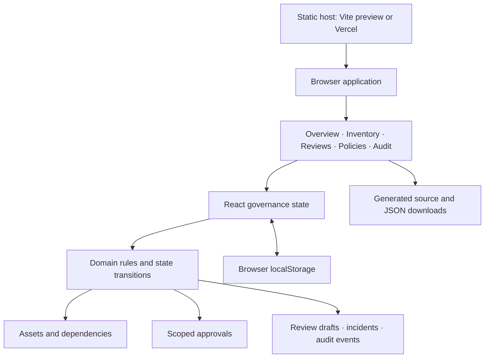
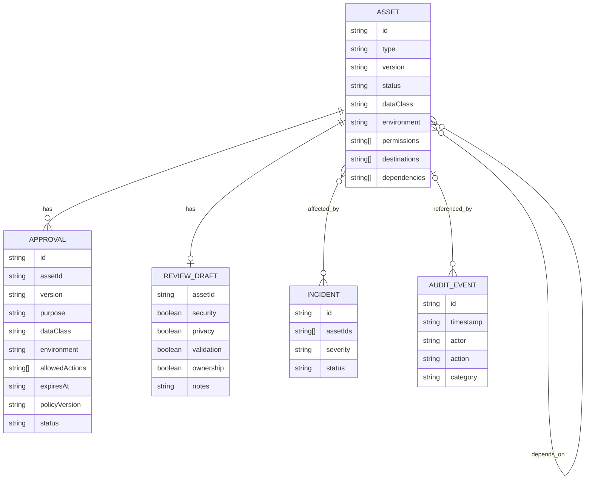

# System design

Steward is a static React and TypeScript application built with Vite. Its primary scope is MCP server governance: releases, tool permissions, data access, review evidence, and ongoing change oversight. Agent skills remain a secondary scope. The demonstration does not connect to NIH systems, external assets, an identity provider, or a policy enforcement gateway.

The product idea is a governance workflow backed by specific approval scopes, with a catalog supporting discovery and reuse. A catalog entry describes an asset; an approval describes the version, purpose, data class, environment, actions, conditions, policy version, reviewer, and validity period under which that asset was approved. Finding an asset in the catalog does not imply permission to invoke it.

Overview metrics, risk, activity, and review priorities focus on MCP servers. Inventory starts on **MCP servers**, followed by **Agent skills** and **All assets** tabs. Review defaults to Lab Workspace File Index, registration defaults to an MCP server, and the lab defaults to Imaging Metadata Connector. Secondary skills remain available through explicit selection and participate in dependency checks.

## Components and data flow



The static host serves application files. All governance decisions and state changes happen in the visitor's browser. The invocation simulation evaluates a request; it does not invoke an MCP server, execute a skill, or enforce a restriction in another tool.

## Repository organization

```text
nci-governance-poc/
├── src/                 React UI, styles, and browser persistence
│   ├── data/            Synthetic seed assets and evidence
│   └── domain/          Domain types and governance rules
├── public/mock-assets/  Inspectable synthetic source packages
├── docs/                Design and demo guidance
├── tests/               Playwright browser scenarios
├── package.json         Development, validation, and build commands
├── package-lock.json    Reproducible dependency resolution
├── .nvmrc               Node 22 selection
└── vercel.json          Static deployment settings and response headers
```

Domain tests live beside the engine in `src/domain/engine.test.ts`; browser scenarios are in `tests/governance.spec.ts` and run through `test:e2e`. The source code is the authoritative description of implemented behavior; this document describes product boundaries and the domain model rather than a production API contract.

## Domain model



These are TypeScript objects in one versioned state document, not database tables. Asset types are MCP servers and skills; other AI asset types are a future extension. Data classes are the simplified demo labels `Public`, `Internal`, and `Controlled`, not a complete federal data-classification scheme.

## Review and lifecycle

The implemented scenarios demonstrate the following transitions:

```mermaid
stateDiagram-v2
    state "In review" as InReview
    InReview --> Approved: Required checks and rationale; policy permits approval
    InReview --> Rejected: Reviewer records rejection
    Approved --> Suspended: Material upstream change
    note right of Suspended
        Affected approvals become invalidated.
        Dependent asset is suspended.
        An incident and audit events are recorded.
    end note
```



Lab Workspace File Index (`mcp-labfiles`) is the positive MCP review example: synthetic `Internal` file metadata, `read:file-metadata`, and the `Research sandbox` environment, with passing evidence. The reviewer completes security, privacy, validation, and ownership checks and records decision rationale. A clinical MCP submission illustrates a hard block: a `Controlled` data scope with an external destination cannot be approved under the demo policy. Completing a checklist does not override that block.

The imaging-change scenario is deterministic. It upgrades the governance metadata for `mcp-imaging` from `1.2.0` to `1.3.0` and adds `write:cohort`. This changes the approved capability scope and affects Public Imaging Cohort Planner (`skill-cohort`), which depends on that server. The source preview and download remain the bundled `1.2.0` snapshot; the UI explicitly identifies this after the scenario. Resetting restores the original versions and decisions.

The changed release also receives a blocking missing-validation finding. Checking the review attestations cannot reauthorize it using the old release's evidence. Uploading replacement evidence and closing the incident are future workflows; this POC demonstrates detection, containment, and routing for reassessment.

Review checkboxes and rationale are saved as a draft during editing. Draft edits do not create audit events. Recording a decision creates the review event and updates the asset and approval records. New approvals expire after the demo's 90-day validity period.

## Invocation simulation

The simulation lab checks a selected asset and requested data class, action, and environment against current governance state. The decision considers asset status, approval scope and validity, dependencies, and applicable demo policy restrictions. The result includes reasons and is recorded in the audit trail.

An allowed result means that the simulated request satisfies the implemented demo rules at that moment. It is not a production authorization, and it provides no guarantee about actual code behavior, research validity, data leakage, or an external service's controls.

## Persistence, errors, and evidence

- `GovernanceState` includes a schema version and holds assets, approvals, review drafts, incidents, audit events, and the upstream-scenario flag.
- Browser storage uses the key `steward-governance-demo-v1` and keeps a visitor's demo across reloads. It is origin-specific; another device, browser, profile, or deployment URL has separate state.
- A targeted presentation update can prepare the old Lab Workspace File Index seed for review only if that draft and its review are entirely untouched and it has no active approval. It adds an audit event and preserves other assets, existing decisions, and edited drafts; it does not reset the workspace.
- If reading or parsing stored state fails, or its expected shape/version is invalid, loading falls back to a fresh synthetic workspace with a warning. This is recovery for a demonstration, not a general database migration or security validation of imported state.
- If saving fails, the UI warns that the session will not survive a reload. In-memory exploration and export remain available. Tabs are not synchronized; concurrent tabs can overwrite the same origin's saved snapshot.
- Reset is a demo convenience that discards local changes and restores synthetic data. There is no shared recovery service, revision database, or server transaction log.
- Client-side form validation and policy checks improve the demonstration; a user can bypass them by editing the application or browser storage.
- Generated JSON packages include the full local state, an export-format identifier, timestamp, policy version, synthetic-data marker, and limitations notice. Export also records a system event. Source artifacts are synthetic downloads, not retrieved package contents or signed provenance.
- Audit records are append-only by application convention. Browser control, reset, or storage deletion can alter the history. They are not cryptographically sealed or independently timestamped.
- Static deployment errors, unavailable browser storage, download restrictions, and unsupported browsers remain client/hosting concerns. The proof of concept has no server health checks, centralized error collection, conflict resolution, or service-level guarantee.

## Security and policy limits

There is no real authentication, role enforcement, secret management, execution sandbox, package scanner, signature verification, network gateway, external revocation, or automated compliance assessment. Any displayed reviewer or role represents a demo persona.

The policy library is deliberately illustrative. Its approval workflow must not be interpreted as NIH/NCI policy, a delegated authority decision, an ATO, or FedRAMP certification. Federal applicability depends on the actual system, use case, data, procurement, and authorization boundary. Applicable NIH authorities would need to confirm those decisions for a real implementation.

The site uses synthetic content and no government seal. Its static response headers are useful deployment defaults, not evidence that government security or privacy requirements have been met.

## Evolution into a production service

1. **Confirm authority and scope.** Agree on accountable NIH/NCI owners, approval delegations, data categories, prohibited uses, records requirements, and integration with existing security and privacy processes.
2. **Move trust to the server.** Add an authenticated service and database; integrate approved SSO/PIV arrangements; enforce RBAC or finer-grained permissions on every operation; make server-side policy decisions authoritative.
3. **Protect evidence.** Store versioned artifacts, reviews, approvals, change events, and audit records with controlled access, appropriate integrity protections, retention, legal hold, and export. Minimize sensitive payloads in logs.
4. **Connect actual enforcement.** Integrate approved runtimes or gateways, short-lived credentials, least-privilege tools, destination restrictions, and revocation. Include local-client paths that a remote gateway cannot see.
5. **Verify the supply chain.** Add repository/package ingestion, immutable version identifiers, dependency inventories, relevant security and license scanning, provenance verification, and change-triggered reassessment.
6. **Validate operations.** Conduct accessibility testing, threat modeling, privacy analysis, applicable control assessment and authorization, recovery testing, monitoring, and incident-response exercises with the responsible NIH teams.

These steps are design directions. No production integrations or federal authorization have been implemented in this proof of concept.
